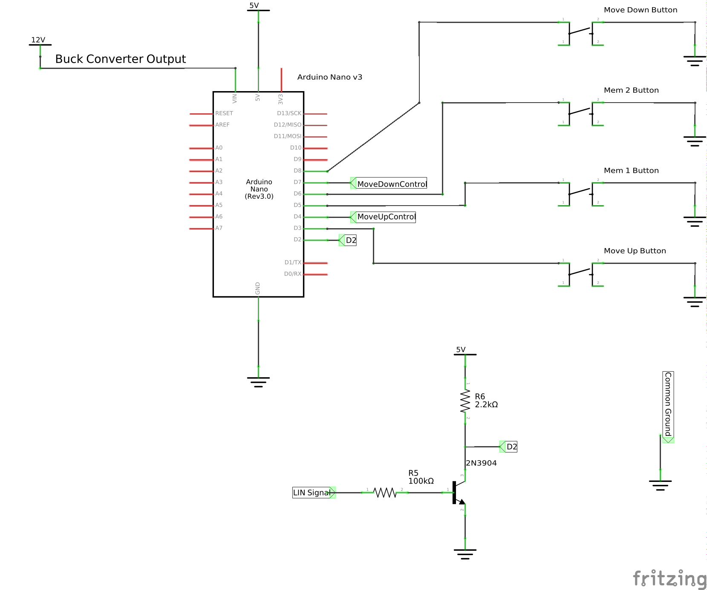
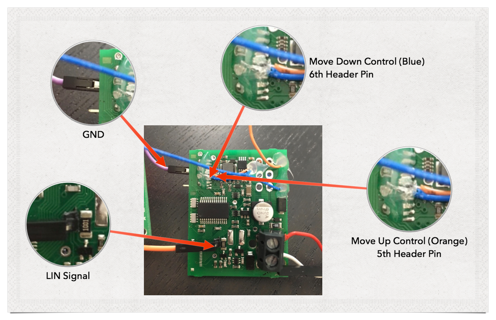

# IKEA Hackant

A simple LIN slave attached to the stock controller board adds two memory buttons.
If you are interested in how this was developed check out my YouTube Tutorial

## Memory buttons

- M1 or M2 short: move to memory 1 / 2
- M1 or M2 held for 1 s: store the current height in memory 1 / 2
- M1 + M2 together short: move to memory 3
- M1 + M2 together held for 1 s: store the current height in memory 3

M1 and M2 don't have to be pressed or released at exactly the same time; a press is
evaluated 50 ms after both buttons were released. Memory 3 is also available via the
serial commands `M3`, `M3<n>` and `S3` (send `HELP` for all commands).

## Schematics

Simple schematics created with [Fritzing](http://fritzing.org/home/ "Fritzing").

